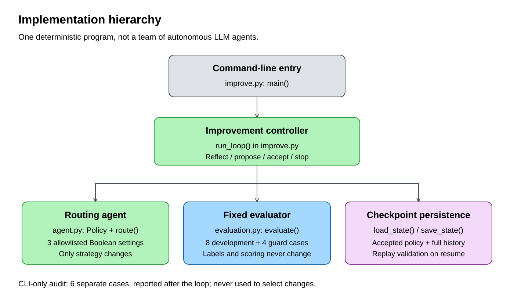
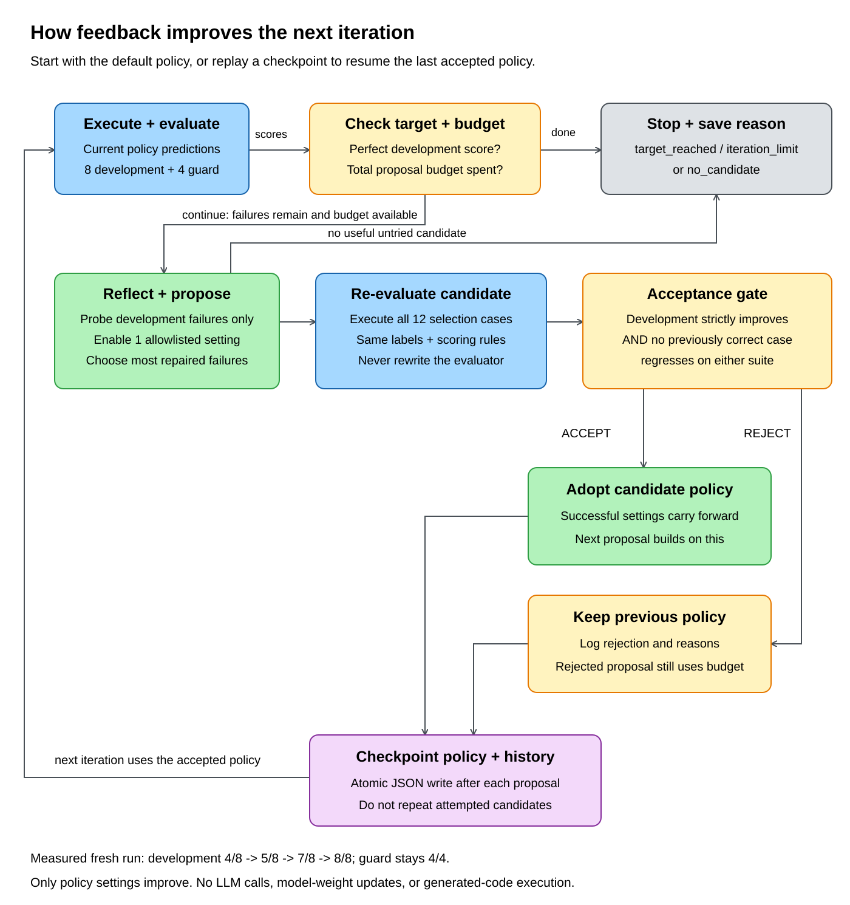

# recursive-self-improvement-demo

A runnable, credential-free demonstration of an agent improving its own
**strategy** through a bounded feedback loop:

**Execute -> evaluate -> reflect on failures -> propose a policy -> re-evaluate
-> accept or reject -> repeat.**

This is a deterministic, offline agent, **not an LLM or model-training system**.
It routes support tickets to `billing`, `account`, `security`, or `other`. Its
initial strategy makes real mistakes; feedback selects changes to case handling,
word matching, and routing priority. Accepted changes affect the next iteration.
Scores are computed from predictions, not generated from an iteration counter.

## Run

Requires **Python 3.10+**, with no third-party dependencies, API keys, or network
access. From the repository root:

```powershell
python improve.py
python -m unittest discover -s tests -v
```

The expected fresh-run trajectory on the included fixed dataset is:

| Policy change | Development | Regression guard |
|---|---:|---:|
| Initial strategy | 4/8 (50%) | 4/4 |
| Normalize case | 5/8 (62.5%) | 4/4 |
| Prioritize security | 7/8 (87.5%) | 4/4 |
| Match whole words | 8/8 (100%) | 4/4 |

A separate audit, never passed to reflection or acceptance, is expected to move
from 2/6 to 6/6. These tiny, public, hand-authored examples illustrate behavior;
they are **not evidence of general intelligence or production accuracy**.

## Persistence and resume

The default checkpoint is `.improvement/state.json` (gitignored). It stores the
accepted policy, per-case predictions, feedback, proposal rationale, decisions,
and termination reason. A rerun loads and verifies that history, then continues
from the accepted strategy. A completed rerun makes no additional changes.

Observe a partial run and resume it with a larger **total** proposal budget:

```powershell
python improve.py --state .improvement\partial.json --max-iterations 1
python improve.py --state .improvement\partial.json --max-iterations 6
```

Use an unused `--state` path to start independently. Existing checkpoints are
never silently reset. Stop reasons are `target_reached`, `iteration_limit`, and
`no_candidate`. Rejected candidates consume budget but do not change the live
policy.

## How evaluation and improvement work

### Implementation hierarchy



The CLI calls one controller, which uses the routing agent, evaluator, and local
checkpoint helpers. These are Python modules/functions, not separate LLM agents.
The evaluator owns the labels and scoring; only allowlisted policy settings change.

### Iteration and feedback



Each accepted strategy becomes the starting point for the next proposal.
Rejections keep the previous strategy but still consume the proposal budget.
The loop stops on a perfect development score, the total budget, or no useful
untried candidate. The separate audit reports results without selecting changes.

Editable diagrams: [hierarchy source](docs/diagrams/hierarchy.excalidraw) and
[feedback-loop source](docs/diagrams/feedback-loop.excalidraw). Open either file
in [Excalidraw](https://aka.ms/excalidraw).
PNG downloads: [hierarchy](docs/diagrams/hierarchy.png) and
[feedback loop](docs/diagrams/feedback-loop.png).

Read [Evaluation and improvement](docs/EVALUATION.md) for the dataset, exact
scoring and acceptance criteria, reflection algorithm, persistence guarantees,
termination rules, limitations, and how this pattern translates to LLM agents.

| File | Responsibility |
|---|---|
| `agent.py` | Ticket execution and the three allowlisted strategy settings |
| `evaluation.py` | Fixed labeled cases, scoring, and dataset fingerprint |
| `improve.py` | Reflection, guarded acceptance, checkpoints, and CLI |
| `tests/test_improve.py` | Behavior, regression, termination, persistence, and CLI tests |

No generated code is executed, no evaluator expectations are changed, and no
model weights are updated. "Recursive" describes repeated feedback into the
agent's next behavior; the implementation is an iterative loop, not an
unbounded recursive function.
